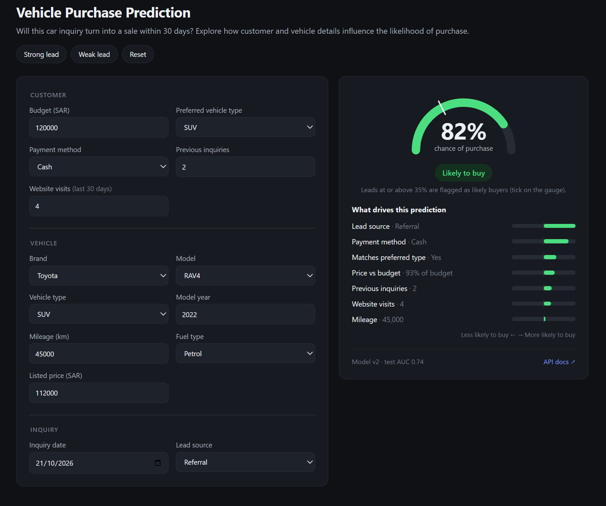

# Vehicle Purchase Prediction

Predicts whether a car inquiry turns into a purchase within 30 days, served through a FastAPI REST API with a web app on top.



## Model review

All numbers below are measured on the newest 20% of inquiries (23 May to 30 Sep 2026, 3,982 rows), so the model is scored on data later than what it learned from.

| Model | ROC AUC | F1 | Precision | Recall | Brier (lower is better) |
|---|---|---|---|---|---|
| Original model (`vehicle_purchase_model.joblib`, threshold 0.40) | 0.720 | 0.659 | 0.575 | 0.772 | 0.212 |
| **v2 model (this folder, threshold 0.35)** | **0.740** | **0.674** | 0.565 | 0.836 | **0.205** |

Five-fold time-series cross-validation confirms the gain is consistent: the v2 feature set beats the original in every fold (mean AUC 0.706 to 0.722).

### What was wrong or missing in the original

1. **No price-to-budget ratio.** Purchase rate falls steadily from 63% when the car costs under 81% of the budget to 26% when it costs over 123%. The original only had the absolute gap in SAR, which treats a 10,000 SAR overshoot the same on a 40,000 SAR car as on a 400,000 SAR one. v2 adds `Log_Budget_Ratio` and `Over_Budget`. This is the main improvement.
2. **`Car_Model` added noise.** 38 one-hot columns, many with few rows, and dropping it slightly improved every fold. `Brand` and `Vehicle_Type` carry the useful signal. The API still accepts `Car_Model` for record keeping.
3. **Threshold.** 0.35 gives the best F1 on the test window. It favours catching buyers (recall 0.84) over precision; raise it if follow-up calls are expensive.
4. **Reproducibility.** The notebook upload was empty, the model was pickled with scikit-learn 1.7.2, and the API existed only as a compiled `.pyc`. `train.py` now rebuilds the model from the Excel file, and `requirements.txt` pins versions so the saved model loads without warnings.

### What did not help

Gradient boosting (HistGradientBoosting) scored 0.726 to 0.734 AUC, no better than logistic regression, and month or weekday features added nothing. The data looks close to its ceiling at roughly 0.74 AUC with these columns; a meaningful jump would need new information such as test-drive booked, salesperson response time or the customer's financing approval.

### Strongest drivers (v2 coefficients)

Positive: Referral and Walk-in leads, Cash buyers, the car matching the preferred type, more previous inquiries and website visits.
Negative: Financing "Undecided" (29.5% buy rate vs 51.9% for Cash), TikTok, X and Snapchat leads, and the price being above the budget.

## Project layout

```
app/features.py   feature engineering shared by training and the API
app/main.py       FastAPI application
app/static/       web app (single HTML page, no build step)
train.py          retrains and evaluates the model, writes models/
models/           vehicle_purchase_model_v2.joblib, evaluation_v2.json
data/             Car_Inquiries_Dataset.xlsx
tests/            API tests
```

## Run it

```bash
python -m venv .venv
.venv\Scripts\activate          # Windows (macOS/Linux: source .venv/bin/activate)
pip install -r requirements.txt
uvicorn app.main:app --reload
```

Open http://127.0.0.1:8000 for the web app, or http://127.0.0.1:8000/docs for the interactive Swagger page.

To retrain after adding data: `python train.py` (or `python train.py path/to/new.xlsx`). Run the tests with `pytest`.

## Run it on Windows PowerShell

```powershell
# 1. Unzip and enter the folder (adjust the path to where you saved the zip)
Expand-Archive -Path "$HOME\Downloads\car-purchase-api.zip" -DestinationPath "$HOME\Downloads"
cd "$HOME\Downloads\car-purchase"

# 2. Create and activate a virtual environment
python -m venv .venv
Set-ExecutionPolicy -Scope Process -ExecutionPolicy Bypass   # only if activation is blocked
.\.venv\Scripts\Activate.ps1

# 3. Install the libraries
pip install -r requirements.txt

# 4. Start the API (leave this window open)
uvicorn app.main:app --reload
```

Open http://127.0.0.1:8000 for the web app (fill in an inquiry, see the probability and what drives it), or http://127.0.0.1:8000/docs to try the raw API. To call it from a second PowerShell window:

```powershell
$body = @{
  Inquiry_Date = "2026-09-15"; Customer_Budget_SAR = 120000
  Preferred_Vehicle_Type = "SUV"; Lead_Source = "Referral"
  Website_Visits_Last_30_Days = 4; Previous_Inquiries = 2
  Financing_Preference = "Cash"; Brand = "Toyota"; Car_Model = "RAV4"
  Vehicle_Type = "SUV"; Model_Year = 2022; Mileage_KM = 45000
  Fuel_Type = "Petrol"; Listed_Price_SAR = 112000
} | ConvertTo-Json

Invoke-RestMethod -Uri http://127.0.0.1:8000/predict -Method Post -ContentType "application/json" -Body $body
```

In Windows PowerShell 5.1, `curl` is an alias for `Invoke-WebRequest`, so use `Invoke-RestMethod` as above instead of the curl example below.

To retrain: `python train.py`. To run the tests: `pytest`.

## Endpoints

| Method | Path | Purpose |
|---|---|---|
| GET | `/` | Web app |
| GET | `/health` | Liveness check |
| GET | `/model-info` | Model version, threshold, features and test metrics |
| POST | `/predict` | Score one inquiry |
| POST | `/predict/explain` | Score one inquiry and list the factors that raised or lowered it (used by the web app) |
| POST | `/predict/batch` | Score up to 1,000 inquiries |

Example request:

```bash
curl -X POST http://127.0.0.1:8000/predict -H "Content-Type: application/json" -d '{
  "Inquiry_Date": "2026-09-15", "Customer_Budget_SAR": 120000,
  "Preferred_Vehicle_Type": "SUV", "Lead_Source": "Referral",
  "Website_Visits_Last_30_Days": 4, "Previous_Inquiries": 2,
  "Financing_Preference": "Cash", "Brand": "Toyota", "Car_Model": "RAV4",
  "Vehicle_Type": "SUV", "Model_Year": 2022, "Mileage_KM": 45000,
  "Fuel_Type": "Petrol", "Listed_Price_SAR": 112000}'
```

Response:

```json
{"purchase_probability": 0.8166, "will_purchase": true, "threshold": 0.35, "model_version": "v2"}
```

Invalid input (unknown fuel type, negative budget, a model year after the inquiry date) returns HTTP 422 with a message naming the field.
